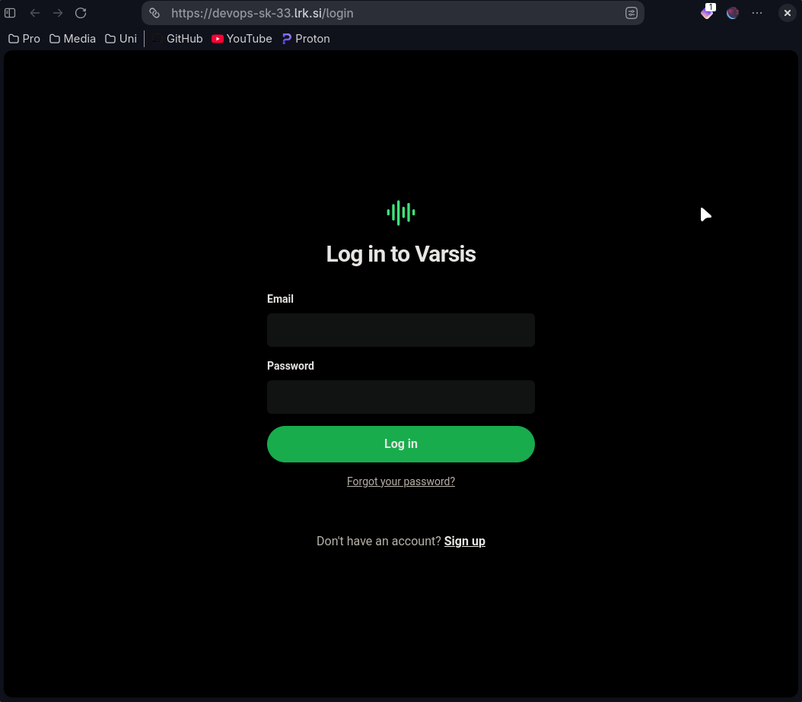
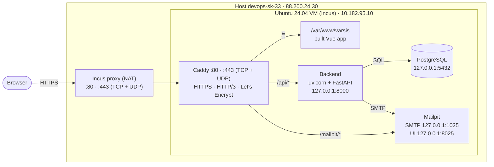
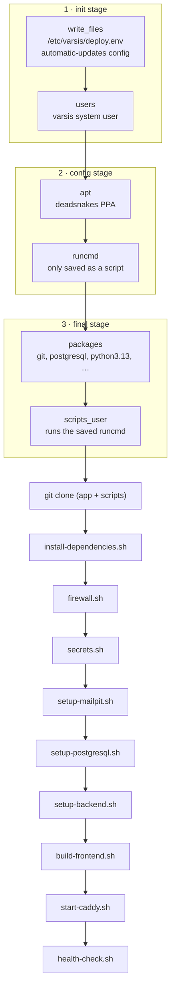
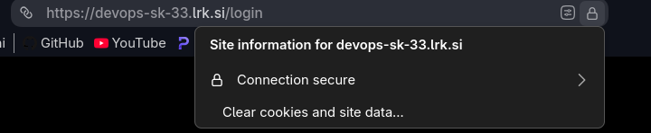

# Varsis: automated VM deployment with cloud-init

**Team sk-33:** `Bor Furlan`, `Matic Grobolšek` &nbsp;·&nbsp; **Live deployment:**
https://devops-sk-33.lrk.si

The usage of the app is shown live at the defense.

## Contents

1. [Project purpose](#1-project-purpose)
2. [Architecture and components](#2-architecture-and-components)
3. [Repository structure](#3-repository-structure)
4. [Deployment with cloud-init](#4-deployment-with-cloud-init)
5. [How the cloud-config works](#5-how-the-cloud-config-works)
6. [Security](#6-security)
7. [Logging](#7-logging)
8. [Usage](#8-usage)
9. [Local testing](#9-local-testing)
10. [Extra features](#10-extra-features)
11. [Vagrant version](#11-vagrant-version)
12. [Known limitations](#12-known-limitations)

## 1. Project purpose

**Varsis** is a self-hosted music server for lossless audio. Users upload albums (FLAC, WAV, …), Varsis reads their
tags and cover art, and everyone with an account can browse, play and download the shared library and make
playlists. Accounts need email verification and admin approval; each user has an upload quota.

The goal of this homework: **one file, [`cloud-init/user-data.yaml`](cloud-init/user-data.yaml), turns an empty
Ubuntu 24.04 VM into a production deployment** of the whole stack, with HTTPS, without any manual step inside the
VM.



## 2. Architecture and components



| # | Component | Role | Installed from |
|---|---|---|---|
| 1 | **Caddy** | HTTPS (automatic Let's Encrypt certificate + renewal), reverse proxy, static files, security headers, request size limits, JSON access log | Caddy's official apt repository |
| 2 | **Backend** (FastAPI on uvicorn, Python 3.13) | REST API: accounts, auth, library, uploads, playlists | Python from the deadsnakes PPA (apt); Python packages pinned in `uv.lock`, installed with `uv` |
| 3 | **PostgreSQL 16** | Database: users, tracks, albums, playlists | Ubuntu apt |
| 4 | **Frontend** (Vue 3 + Tailwind) | Single-page web app; built once at boot, then only static files | Node.js 24 from the NodeSource apt repository (build tool only) |
| 5 | **Mailpit** | Catches every email the app sends (verification, password reset) and shows it in a web UI | Pinned GitHub release binary, checked against its SHA-256 (not packaged in apt) |
| 6 | **ufw** | Host firewall inside the VM: only 22, 80, 443 open | Ubuntu apt |
| 7 | **unattended-upgrades** | Installs updates every day: Ubuntu's security updates, plus Caddy and Python 3.13 | Ubuntu apt (configured in `write_files`) |
| | **systemd** | Runs the backend and Mailpit as sandboxed services | (part of Ubuntu) |

Host side (the VM's host): **Incus** (VM manager, apt) with **QEMU/KVM** (apt).

## 3. Repository structure

```
deploy/
├── README.md                ← this file
├── img/                      ← screenshots used in this file
├── cloud-init/
│   ├── user-data.yaml        ← the cloud-config: settings, packages, runcmd
│   ├── scripts/              ← one setup script per step (run by runcmd from the cloned repo)
│   ├── files/                ← Caddyfile template, systemd units
│   ├── README.md             ← settings and the cloud-init stage order
│   ├── EXPLAINED.md          ← step-by-step explanation of user-data.yaml and the scripts
│   └── SERVER-SETUP.md       ← step-by-step deployment on our server, incl. every problem we hit
├── vagrant/                  ← Vagrant version, development (see section 11)
│   ├── Vagrantfile
│   ├── scripts/              ← one provisioning script per step
│   ├── files/                ← nginx site, systemd units
│   └── README.md
└── docker/                   ← (the app's own Docker Compose setup, not part of this homework)
backend/                      ← FastAPI app
frontend/                     ← Vue app
```

## 4. Deployment with cloud-init

Full walkthrough with explanations and troubleshooting: [`cloud-init/SERVER-SETUP.md`](cloud-init/SERVER-SETUP.md).
Short version:

**Host (once):** Ubuntu 24.04 with KVM, ports 80/443 reachable from the internet, DNS A record of the domain →
host IP.

```bash
sudo apt install incus qemu-system-x86 ovmf qemu-utils
sudo usermod -aG incus-admin $USER && newgrp incus-admin
incus admin init                                   # btrfs storage pool, incusbr0 bridge (answers in SERVER-SETUP.md)
sudo ufw allow in on incusbr0 && sudo ufw route allow in on incusbr0 && sudo ufw route allow out on incusbr0
```

**Settings:** copy `user-data.yaml` and set the `deploy.env` block at its top:

```bash
cp deploy/cloud-init/user-data.yaml varsis.yaml    # DOMAIN=devops-sk-33.lrk.si, ADMIN_EMAILS=…, MAILPIT=true
```

**Launch + port forwarding:**

```bash
incus launch images:ubuntu/24.04/cloud varsis --vm \
  -c limits.cpu=2 -c limits.memory=2GiB -d root,size=15GiB \
  -d eth0,ipv4.address=10.182.95.10 \
  -c cloud-init.user-data="$(cat varsis.yaml)" \
  -c boot.autostart=true
incus config device add varsis http  proxy nat=true listen=tcp:88.200.24.30:80  connect=tcp:10.182.95.10:80
incus config device add varsis https proxy nat=true listen=tcp:88.200.24.30:443 connect=tcp:10.182.95.10:443
incus config device add varsis http3 proxy nat=true listen=udp:88.200.24.30:443 connect=udp:10.182.95.10:443
incus exec varsis -- tail -f /var/log/cloud-init-output.log    # … [varsis-setup] done: https://devops-sk-33.lrk.si
```

**Deployment time:** about **2.5 minutes** from `incus launch` to a working site on our server (first boot,
including all package installs and the frontend build): `Varsis cloud-init finished after 163.65 s` in the
screenshot below.

![End of cloud-init-output.log: Caddy configured, "[varsis-setup] done", total time](img/deploy.png)

The same `user-data.yaml` also works unchanged on any cloud provider: paste it into the "user data" field when
creating an Ubuntu 24.04 server.

### Settings (`/etc/varsis/deploy.env` block)

| Variable | Meaning |
|---|---|
| `DOMAIN` | Public host name. Set: Caddy gets a Let's Encrypt certificate. Empty: the VM's IP with a certificate from Caddy's local CA |
| `SITE` | Only for VMs reached through port forwarding on another port; empty otherwise |
| `REPO_URL`, `REPO_REF` | Which repository and branch to deploy |
| `ADMIN_EMAILS` | Accounts that become admins |
| `DEFAULT_QUOTA_GB` | Upload space per new user |
| `SMTP_*` | A real mail provider (production) |
| `MAILPIT` | `true`: all mail goes to Mailpit instead |

The block is read by bash: put a value with spaces or special characters in single quotes (`SMTP_PASS='abc$def'`),
don't use quote characters or backslashes inside a value, and write `ADMIN_EMAILS` without spaces.

## 5. How the cloud-config works

cloud-init runs its modules in a fixed order, in three stages:

| Stage | Modules used here | What happens |
|---|---|---|
| **init** | `write_files`, `users_groups` | The settings (`/etc/varsis/deploy.env`) and the automatic-updates config are written; then the `varsis` system user is created |
| **config** | `apt_configure`, `runcmd` | The deadsnakes PPA is added; `runcmd` is only **saved** as a script here, not run |
| **final** | `package_update_upgrade_install`, `scripts_user` | `packages:` are installed, **then** the saved `runcmd` script runs |



So `runcmd` already runs after every package from `packages:` is installed (the question from the assignment tip);
no extra ordering module is needed. Because `write_files` runs **before** the `varsis` user exists, no file written
there may be owned by that user (it would need `defer: true`); ownership of the data folders is set later in the
setup script.

`runcmd` clones the app repository and runs the setup scripts from it, **one script per step**, like the Vagrant
version. They are normal files in [`cloud-init/scripts/`](cloud-init/scripts); the config files they install are
in [`cloud-init/files/`](cloud-init/files):

| # | Step | What it does |
|---|---|---|
| 1 | clone (in runcmd) | `git clone` of `REPO_URL` at `REPO_REF`: the app and these scripts |
| 2 | `install-dependencies.sh` | Adds the Caddy and NodeSource apt repositories (keys pinned with `signed-by`) and installs both |
| 3 | `firewall.sh` | ufw allows 22, 80, 443 |
| 4 | `secrets.sh` | Generates the secrets (database password, `SECRET_KEY`) **on the VM**: never stored in the repository |
| 5 | `setup-mailpit.sh` | Mailpit (when enabled): pinned release, checked against its SHA-256 |
| 6 | `setup-postgresql.sh` | PostgreSQL role and database |
| 7 | `setup-backend.sh` | uv (pinned version), exact package versions from `uv.lock`, `backend.env`, systemd service |
| 8 | `build-frontend.sh` | Frontend build, copied to `/var/www/varsis` |
| 9 | `start-caddy.sh` | Caddy config from the template, validated, reloaded |
| 10 | `health-check.sh` | Waits until the backend answers its health check, then checks that Caddy answers for the site (http → https redirect) |

`common.sh` is sourced by every step (settings, secrets, helpers). runcmd starts with `set -e`, so the first
failing step stops the rest and cloud-init reports an error.

The steps are **idempotent** (can run again): the clone, secrets and database are skipped if they exist. That is
also how the app is updated: `git pull`, then `sudo sh /var/lib/cloud/instance/scripts/runcmd` (runcmd as
cloud-init saved it).

Because the VM clones the scripts, `REPO_URL` must be public and script changes must be pushed before a new VM
sees them.

Details per line: [`cloud-init/EXPLAINED.md`](cloud-init/EXPLAINED.md).

## 6. Security

| Area | Measure |
|---|---|
| **HTTPS** | Valid **Let's Encrypt** certificate, obtained and renewed automatically by Caddy (ACME HTTP-01 / TLS-ALPN-01); HTTP redirects to HTTPS; **HSTS** |
| **HTTP headers** | `X-Content-Type-Options: nosniff`, `X-Frame-Options: DENY`, `Referrer-Policy: same-origin`, `Server` header removed |
| **Request limits** | JSON bodies max 1 MB, only `/api/upload` up to 2 GB |
| **Authentication** | Passwords hashed with **Argon2** (`pwdlib`); session in an `HttpOnly`, `Secure`, `SameSite=Lax` cookie; email verification; signed, expiring tokens for verification/reset links |
| **Authorization** | Admin approval of new accounts; admin role; users may only edit their own tracks; per-user storage quota |
| **Rate limiting** | Login, sign-up and outgoing mail are rate-limited per IP / per email. The Incus port forward uses NAT (`nat=true`), so the VM sees real client IPs |
| **Secrets** | Generated on the VM at first boot into `/etc/varsis/secrets.env` (mode 600); never in git |
| **Network exposure** | Backend, PostgreSQL and Mailpit listen on `127.0.0.1` only; ufw allows 22/80/443; Mailpit UI behind a password (bcrypt, Caddy `basic_auth`) |
| **Process isolation** | Backend runs as its own unprivileged `varsis` user with systemd sandboxing (`ProtectSystem=strict`, `NoNewPrivileges`, `PrivateTmp`, `PrivateDevices`, writes only `/var/lib/varsis`); Mailpit with `DynamicUser` |
| **Supply chain** | apt repository keys pinned per repository (`signed-by`); Python dependencies locked (`uv sync --frozen`), uv itself pinned; Mailpit release pinned to a version and checked against its SHA-256 |
| **Updates** | `unattended-upgrades` installs updates every day: Ubuntu's security updates, plus Caddy's repository and the deadsnakes PPA (configured in `write_files`) |



## 7. Logging

| What | Where | Command |
|---|---|---|
| Deployment log | `/var/log/cloud-init-output.log` | `incus exec varsis -- tail -f /var/log/cloud-init-output.log` |
| Backend | journald | `incus exec varsis -- journalctl -u varsis-backend -f` |
| Requests (JSON, one line per request; tokens from email links removed) | `/var/log/caddy/varsis-access.log` | `incus exec varsis -- tail -f /var/log/caddy/varsis-access.log` |
| Caddy, certificates | journald | `incus exec varsis -- journalctl -u caddy` |
| PostgreSQL | journald / `/var/log/postgresql/` | `incus exec varsis -- journalctl -u postgresql` |
| Health check | `GET /api/health` | `curl https://devops-sk-33.lrk.si/api/health` → `{"ok":true}` |
| Service state | systemd | `incus exec varsis -- systemctl status varsis-backend caddy postgresql mailpit` |
| Automatic updates | `/var/log/unattended-upgrades/` | `incus exec varsis -- tail /var/log/unattended-upgrades/unattended-upgrades.log`; which repositories it updates from: `incus exec varsis -- unattended-upgrade --dry-run --debug \| grep "Allowed origins"` |

## 8. Usage

1. Open https://devops-sk-33.lrk.si and **register** with an address from `ADMIN_EMAILS`.
2. Open **Mailpit** at https://devops-sk-33.lrk.si/mailpit/ (user `mailpit`, password:
   `incus exec varsis -- grep MAILPIT_PASSWORD /etc/varsis/secrets.env`) and click the verification link.
3. Log in, **upload** an album folder, play it.
4. A second user registers → the admin gets an email → approves them on the **Admin** page.

## 9. Local testing

The same `user-data.yaml` runs locally before it goes to the server:

| Tool | Command | Notes |
|---|---|---|
| **Incus** | see [`cloud-init/README.md`](cloud-init/README.md) | Same as the server; VM gets an IP on `incusbr0` |

## 10. Extra features

- **Valid HTTPS with automatic renewal** (Let's Encrypt via Caddy), HSTS, security headers
- **Mailpit** as a mail catcher, password-protected, switchable with one setting (`MAILPIT=true/false`)
- **One file, two modes:** with `DOMAIN` set it's production (Let's Encrypt), empty it's a local VM (Caddy's own CA)
- **Secrets generated on the VM**, never in the repository
- **systemd sandboxing** for the backend and Mailpit
- **Real client IPs** through the NAT port forward (rate limits work per visitor)
- **Idempotent setup script**: re-runnable, also used for updates
- **VM autostart** after a host reboot (`boot.autostart=true`)
- **Fast deployment:** ~2.5 min from launch to a working HTTPS site
- **Health check at the end:** cloud-init reports the deployment as failed unless the backend answers and Caddy
  serves the site
- **Automatic updates** not only from Ubuntu's security archive but also for Caddy and Python 3.13
- **Supply chain:** Mailpit download checked against its SHA-256, uv pinned, Python packages locked
- **No secrets in the logs:** tokens from email links are removed from the access log
- **HTTP/3** (QUIC) through a UDP port forward
- **Vagrant version** for development, with nginx instead of Caddy (section 11)

## 11. Vagrant version

A **development** version in [`vagrant/`](vagrant): a `Vagrantfile` (libvirt provider, box
`cloud-image/ubuntu-24.04`) and one shell script per provisioning step in `vagrant/scripts/`. It deploys the **local
checkout** (rsync synced folder) instead of cloning from GitHub, and uses **nginx** with a self-signed certificate
instead of Caddy, so the two versions show both common web server setups.

```bash
cd deploy/vagrant
ADMIN_EMAILS=you@example.com vagrant up       # https://localhost:8443, mails at https://localhost:8443/mailpit/
```

Details, every script explained, and a comparison with this version: [`vagrant/README.md`](vagrant/README.md).

## 12. Known limitations

- Mailpit is a **development** mail catcher: in real production, `SMTP_*` would point at a mail provider and
  `MAILPIT=false`.
- Mailpit is downloaded from GitHub (pinned version, SHA-256 checked), as it isn't packaged in Ubuntu's apt
  repositories.
- cloud-init only runs on a VM's **first** boot. A changed setting in `deploy.env` can be applied to a running VM
  (edit `/etc/varsis/deploy.env`, re-run `sh /var/lib/cloud/instance/scripts/runcmd`), and so can changed scripts
  (`git pull` first). Changes to the rest of `user-data.yaml` (`packages:`, the automatic-updates config in
  `write_files`) only reach a new VM.
- One VM, no backups or monitoring dashboards yet.
- Python 3.13 comes from deadsnakes, a community PPA: updated when Python releases fixes, but without Ubuntu's
  security team behind it. The backend uses an updated Python after its next restart.
- The login and sign-up rate limits are kept in the backend's memory: a restart of the backend resets them.
